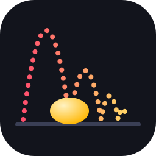

<p align="center"></p>

<h1 align="center">anime-kinetix-claude-plugin</h1>

A Claude Code plugin for kinetic web work: **Anime.js v4** animation, **Matter.js** 2D physics, **PixiJS v8** rendering and **Tone.js** sound, plus the rules for combining them. It keeps Claude on the current API of each library instead of drifting to outdated examples.

- [Install](#install) · [What's included](#whats-included) · [Commands](#commands) · [Skills](#skills) · [Combining the libraries](#combining-the-libraries) · [Examples](#examples) · [Compatibility](#compatibility) · [Updating](#updating) · [Development](#development) · [Credits](#credits)

## Install

The repo is private, so you need GitHub access to `zedalleys/anime-kinetix-claude-plugin`.

```
/plugin marketplace add zedalleys/anime-kinetix-claude-plugin
/plugin install anime-kinetix@anime-kinetix
```

Restart Claude Code after installing. To try it without installing, from a clone:

```
claude --plugin-dir plugins/anime-kinetix
```

The plugin does not install the libraries themselves. Claude asks before running `npm i animejs`, `npm i matter-js`, `npm i pixi.js` or `npm i tone`.

## What's included

| Piece | Type | Purpose |
| --- | --- | --- |
| `animejs` | Skill | Anime.js v4 API and v3 to v4 migration |
| `matterjs` | Skill | Matter.js physics, DOM/canvas syncing, teardown |
| `pixijs` | Skill | PixiJS v8 setup, Graphics, ticker, particles, v7 to v8 migration |
| `tonejs` | Skill | Tone.js synths, samples, scheduling, browser audio unlock |
| `/anime-kinetix:animate` | Command | Write or convert an Anime.js animation |
| `/anime-kinetix:physics` | Command | Add or debug physics, optionally with Anime.js or PixiJS |
| `/anime-kinetix:sound` | Command | Add Tone.js sound, optionally synced to animation or physics |

Skills load automatically when your task mentions the library. Commands are run explicitly.

## Commands

### `/anime-kinetix:animate <description or v3 code>`

Writes a v4 animation or converts v3 code. It:
1. Detects the framework and the installed `animejs` version, and installs only with your consent.
2. Uses `animate`, `createTimeline` and `stagger`, with `revert()` / `createScope` cleanup where the framework needs it.
3. Converts v3 code with the migration table and lists what changed.
4. Handles `prefers-reduced-motion`: it does not start the animation, jumps to the end state with `utils.set`, and never starts `loop: true` animations.

### `/anime-kinetix:physics <what should fall, collide, or be dragged>`

Builds or debugs a Matter.js simulation. It:
1. Detects the framework and whether `matter-js` / `pixi.js` are installed.
2. Stops early on React Native, because Matter.js needs a DOM or canvas, and proposes a web or DOM-component approach.
3. Assigns ownership: Matter for anything that collides, Anime.js for scripted motion, Pixi for drawing many bodies.
4. Writes the simulation with `Composite.add`, `Runner.create` + `Runner.run`, thick static walls and a render path.
5. Adds teardown and a reduced-motion path (no simulation, bodies rendered at rest).

### `/anime-kinetix:sound <what should make sound and when>`

Adds Tone.js audio. It:
1. Detects the framework and whether `tone` is installed, and stops early on React Native (no Web Audio there).
2. Gates all audio behind a user gesture and `await Tone.start()`; it never autoplays.
3. Schedules with the callback `time` and the Transport instead of timers, and reuses instruments.
4. For physics sounds, follows the collision recipe: speed threshold, rate limit, velocity from impact.
5. Adds a mute control, a modest master volume and teardown.

## Skills

### `animejs`

Anime.js v4 (`animejs`, checked against v4.5.0). Rules it enforces: named ESM imports, `animate(targets, params)`, `ease` not `easing`, `alternate: true`, `x`/`y` transform shorthands, `createTimeline`, `stagger`, SVG helpers (`createDrawable`, `createMotionPath`, `morphTo`), `splitText`, `createScope` and `revert()` on unmount. Includes a v3 to v4 rename table.

### `matterjs`

Matter.js (`matter-js`, checked against 0.20.0). Rules it enforces: use `Composite.add` (not the deprecated `World`), `Runner.run` (not `Engine.run`), positions are body centers, thick static walls, one loop only, and full teardown (`Runner.stop`, `Render.stop`, `Events.off`, `Engine.clear`). Includes DOM syncing and the Anime.js ownership rule.

### `pixijs`

PixiJS v8 (`pixi.js`, checked against 8.23.0). Rules it enforces: async `app.init()`, `app.canvas`, chained Graphics (`rect().fill()`), `Assets.load`, ticker `deltaTime` vs `deltaMS`, `ParticleContainer` for large counts, and `app.destroy(true, { children: true })`. Includes a v7 to v8 table and a Pixi-renders-Matter-simulates recipe.

### `tonejs`

Tone.js (`tone`, stable 15.1.22; `next` is 15.5.72). Rules it enforces: `import * as Tone`, `await Tone.start()` from a user gesture, schedule with the passed `time` rather than `setInterval`, `getTransport()` for loops, `PolySynth` for overlapping notes, `await Tone.loaded()` before playing samples, reuse instruments, dispose on unmount. Includes a Matter collision-sound recipe.

## Combining the libraries

The rule that keeps scenes sane: **each property has exactly one owner.**

| Job | Owner |
| --- | --- |
| Positions and rotation of colliding things | Matter.js |
| Scripted motion: entrances, exits, color, opacity, UI | Anime.js |
| Drawing many objects or effects at 60 fps | PixiJS |
| Sound and audio timing | Tone.js |

- **Matter + DOM:** write each body's position to an element's `transform` in `afterUpdate`, subtracting half the element size.
- **Matter + Pixi:** one display object per body, centered on its origin, updated in `afterUpdate`. Do not also step the engine from the Pixi ticker.
- **Matter + Tone:** play a short hit on `collisionStart`, scaled by relative speed, with a speed threshold and rate limit so resting stacks do not buzz.
- **Anime.js + Pixi:** Anime.js can tween numeric properties of Pixi objects (for example `alpha`, `position.x`). Never tween what a physics body also drives.

## Examples

Try prompts like:

```
/anime-kinetix:animate convert this v3: anime({targets: '.dot', translateX: 250, easing: 'easeInOutQuad', direction: 'alternate', loop: true, delay: anime.stagger(100)})
/anime-kinetix:physics 5 DOM cards that fall, pile up on the floor, and can be dragged
/anime-kinetix:physics 300 circles falling into a bin, drawn with Pixi
/anime-kinetix:sound a soft click sound whenever two cards collide
```

The first converts to `animate('.dot', { x: 250, ease: 'inOutQuad', alternate: true, loop: true, delay: stagger(100) })`. The second produces a self-contained page with static walls, mouse dragging, DOM transforms and a reduced-motion branch.

## Compatibility

- **Built for the web, with hybrid-mobile paths.** Everything runs in a browser, and therefore in WebViews, Capacitor/Cordova and Expo DOM components.
- **Outside a browser (for example React Native):** the Matter.js engine and Anime.js animation of plain JS objects are plain JavaScript and run headless (confirmed in Node, not on a device); `Render`, `Mouse`, DOM transforms and CSS animation are web-only. PixiJS needs WebGL and Tone.js needs the Web Audio API, so use a WebView or DOM component for those, or a native alternative. The commands explain this instead of writing code that cannot run.
- Tested against Anime.js 4.5.0, Matter.js 0.20.0, PixiJS 8.23.0, Tone.js 15.1.22. If your installed version differs, the skills tell Claude to check the installed types first.
- The skills were written from each library's source and docs. The advice on tunnelling, teardown and ownership comes from experience, not from the libraries' docs, so treat it as guidance.

## Updating

```
claude plugin marketplace update anime-kinetix
claude plugin update anime-kinetix@anime-kinetix
```

Then restart Claude Code. The updater compares the `version` in `plugin.json`, so a change without a version bump will not be picked up. Always bump the version when you change a skill or command.

## Development

Layout:

```
.claude-plugin/marketplace.json
plugins/anime-kinetix/
  .claude-plugin/plugin.json
  commands/animate.md, physics.md, sound.md
  skills/animejs/    SKILL.md, references/api.md
  skills/matterjs/   SKILL.md, references/api.md
  skills/pixijs/     SKILL.md, references/api.md, references/matter-recipe.md
  skills/tonejs/     SKILL.md, references/api.md, references/motion-recipe.md
```

Workflow: edit, run `claude plugin validate .`, bump the version in `plugins/anime-kinetix/.claude-plugin/plugin.json`, commit, push, then update the installed copy. Test a command in a fresh session, for example `claude -p '/anime-kinetix:physics ...'`.

Adding a library: create `skills/<name>/SKILL.md` with a trigger-focused `description`, read the library's source for its public exports, record only verified facts in `references/api.md`, add the ownership rule to this README, and bump the version.

## Credits

Based on [juliangarnier/anime](https://github.com/juliangarnier/anime), [liabru/matter-js](https://github.com/liabru/matter-js), [pixijs/pixijs](https://github.com/pixijs/pixijs) and [Tonejs/Tone.js](https://github.com/Tonejs/Tone.js), all MIT licensed. This plugin is not affiliated with those projects.

## License

MIT, see [LICENSE](LICENSE). The libraries this plugin documents keep their own MIT licenses (see Credits).
