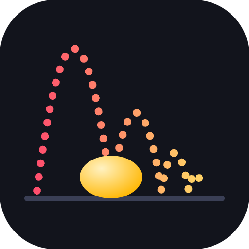

# anime-kinetix

A Claude Code plugin that keeps Claude on the current APIs of four JavaScript libraries when it writes motion, physics, rendering and sound code: **Anime.js v4**, **Matter.js**, **PixiJS v8** and **Tone.js**. It also teaches Claude how to combine them without two libraries fighting over the same property.

## What you get

| Piece | Type | Use it to |
| --- | --- | --- |
| `animejs` | Skill | Write or migrate Anime.js v4 animations |
| `matterjs` | Skill | Add 2D rigid-body physics |
| `pixijs` | Skill | Render with PixiJS v8, including Matter bodies |
| `tonejs` | Skill | Add sound with Tone.js |
| `/anime-kinetix:animate` | Command | Write or convert an Anime.js animation |
| `/anime-kinetix:physics` | Command | Add or debug physics, optionally with Anime.js or PixiJS |
| `/anime-kinetix:sound` | Command | Add Tone.js sound, optionally synced to animation or physics |

Skills load automatically when your task mentions one of the libraries. Commands run when you call them.

## Install

```
/plugin marketplace add zedalleys/anime-kinetix-claude-plugin
/plugin install anime-kinetix@anime-kinetix
```

## What it runs and sends

The plugin contains only Markdown instructions and images. It has no hooks, no MCP servers, no scripts and no network calls of its own.

When you run a command, Claude may check whether a library is installed with `npm ls <package>`. It installs a library (`animejs`, `matter-js`, `pixi.js` or `tone`) only after asking you. Generated code can load libraries from npm or a CDN, and that is shown to you in the code Claude writes.

## Compatibility

Built for web projects, including hybrid mobile (WebView, Capacitor, Expo DOM components). In React Native, the Matter.js engine and Anime.js on plain objects run headless, while rendering, DOM transforms, Pixi and Tone.js need a web context. The full guide is in the repository README.

## Credits and license

MIT licensed, see LICENSE. Based on the public documentation and source of [Anime.js](https://github.com/juliangarnier/anime), [Matter.js](https://github.com/liabru/matter-js), [PixiJS](https://github.com/pixijs/pixijs) and [Tone.js](https://github.com/Tonejs/Tone.js), all MIT licensed. This plugin is not affiliated with those projects.
